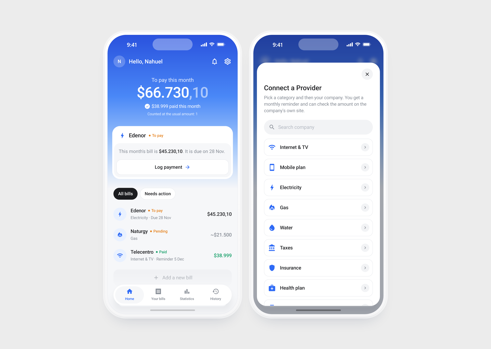

# Billio

An Android app to keep track of household bills: what is due this month, a reminder for every bill, and a record of what you paid.



## What it does

- **Connect a provider.** Pick a category and your company from a bundled list of 100 companies (Argentina and the United States), or type any other company yourself.
- **Monthly reminders.** A notification on the day of the month you choose for each bill, and again when a bill is due tomorrow, due today or overdue.
- **This month's amount.** Billio does not download your bills. It opens the company's own site inside the app, where "Find amount" lists the amounts on the page so you can pick yours. You can also type the amount and the due date yourself.
- **Log what you paid.** The amount, the date and the month it belongs to, or the instalment (2 of 6, for example).
- **Statistics and history.** What you paid each month, the monthly average, the last 6 months, this month by category, and every payment you logged.
- **Private.** Your bills are stored only on the phone, with no account. A backup file lets you move them to another phone.
- **English and Spanish.** The language is picked in Settings.

## Install

Download `Billio.apk` from the [latest release](https://github.com/shinnahu/Billio/releases/latest) and open it on a phone with Android 8.0 or newer.

## Build

It needs JDK 17 and the Android SDK with platform 35.

```
./gradlew :app:assembleRelease
./gradlew :app:testDebugUnitTest
```

The APK is written to `app/build/outputs/apk/release/`.
